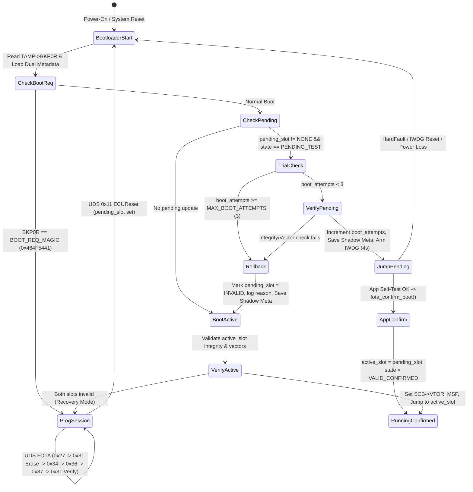

# Spec: Automotive Central Gateway & Secure FOTA over CAN-FD — V1

**Thesis:** Nghiên cứu, thiết kế hệ thống Automotive Central Gateway hỗ trợ cập nhật phần mềm an toàn (Secure FOTA) qua mạng CAN-FD ứng dụng trong ô tô  
**Status:** Approved (V1 Baseline)  
**Last updated:** 2026-11-22  
**Companion docs:** [CONSTRAINTS.md](../../CONSTRAINTS.md) | [README.md](../../README.md) | [docs/architecture/PLAN.md](PLAN.md)

---

## 1. Objective

Build an end-to-end **Automotive Central Gateway & Secure FOTA over CAN-FD** prototype that securely downloads signed firmware packages from a Host PC FOTA Server over Ethernet (HTTPS/TLS), authenticates and routes CAN-FD traffic on an `STM32MP157D-DK1` Embedded Linux Central Gateway, and flashes an `STM32G474VET6` Target ECU over CAN-FD using **ISO-TP (ISO 15765-2)**, **UDS (ISO 14229-1)**, and **SecOC (TinyJAMBU-128 AEAD)** with a fail-safe **Custom Bootloader (A/B Partitioning & Automatic Rollback)**.

### Subsystem Capability Map (V1 Build Order)

| Module ID | Location | Responsibility | Depends On |
|---|---|---|---|
| `shared-proto` | `shared/` | Platform-agnostic C11 libraries: TinyJAMBU-128 AEAD, CAN-FD/SecOC framing, ISO-TP, UDS/FOTA protocol codecs, package & metadata structs | — |
| `fota-server` | `server/` | Python FastAPI HTTPS server + Ed25519/SHA-256 CLI package signer + FOTA telemetry log | `shared-proto` (package format) |
| `gateway-core` | `gateway/app/` | C11 Central Gateway: CAN-FD Routing Table, HTTPS/Ed25519 FOTA Client, UDS Master, SecOC signer/verifier, SocketCAN port | `shared-proto`, `fota-server` |
| `gateway-linux` | `gateway/linux/` | Buildroot custom Linux image + STM32MP157D-DK1 Device Tree (`.dts`) enabling `m_can1`/`m_can2` | `gateway-core` |
| `ecu-bootloader` | `ecu/bootloader/` | STM32G474VET6 Custom Bootloader: Dual-copy Metadata, UDS Programming Server, TinyJAMBU-128 decrypt/verify, A/B Flash programmer, IWDG trial boot & rollback | `shared-proto` |
| `ecu-app` | `ecu/app/` | STM32G474VET6 Target Application (Slot A & Slot B builds): FDCAN1 app, UDS Extended/DID/Reset services, SecOC heartbeat, post-boot health confirmation | `shared-proto`, `ecu-bootloader` |

**Dependency order:** `shared-proto` → (`fota-server`, `gateway-core`, `ecu-bootloader`) → (`gateway-linux`, `ecu-app`) → System Integration (SIL `vcan0` → HIL hardware).

---

## 2. End-to-End System Architecture

```mermaid
flowchart LR
    subgraph HostPC["FOTA Server (Host PC)"]
        SIGN["CLI Signer<br/>Ed25519 + SHA-256"]
        API["FastAPI + Uvicorn<br/>HTTPS / TLS 1.2+"]
        SIGN --> API
    end

    subgraph Gateway["Central Gateway (STM32MP157D-DK1)"]
        LINUX["Buildroot Custom Linux<br/>SocketCAN (m_can1 / can0)"]
        FC["FOTA Client<br/>libcurl + OpenSSL<br/>Ed25519/SHA-256 Verify"]
        ROUTER["CAN-FD Router<br/>Default-Deny Table"]
        UDS_M["UDS Master + ISO-TP<br/>SecOC (TinyJAMBU-128)"]
        FC --> UDS_M --> ROUTER --> LINUX
    end

    subgraph Bus["CAN-FD Physical Bus (500 kbps / 2 Mbps)"]
        T1["MCP2562FD<br/>VDD=5V, VIO=3.3V"]
        WIRE["CANH / CANL Twisted Pair<br/>2 x 120 Ohm Termination"]
        T2["MCP2562FD<br/>VDD=5V, VIO=3.3V"]
        T1 <--> WIRE <--> T2
    end

    subgraph ECU["Target ECU (STM32G474VET6)"]
        HAL["FDCAN1 + Flash + RNG + IWDG"]
        BL["Custom Bootloader (48 KB)<br/>UDS Prog + TinyJAMBU-128<br/>A/B Swap & Rollback"]
        META["Metadata + Freshness (16 KB)<br/>Dual Ping-Pong NVM"]
        SLOTS["Slot A (224 KB) / Slot B (224 KB)<br/>App + UDS Server + SecOC"]
        HAL <--> BL
        HAL <--> SLOTS
        BL <--> META
        SLOTS <--> META
    end

    API <-->|"Ethernet RGMII (HTTPS/TLS)"| FC
    LINUX <-->|"FDCAN1 (PA12/PA11, AF9, 3.3V)"| T1
    T2 <-->|"FDCAN1 (3.3V)"| HAL
```



### Hardware Specifications (Aligned with `docs/latex/sections/task000.tex` & `task001.tex`)

| Component | Part / Platform | Key Hardware Specifications | Interface & Notes |
|---|---|---|---|
| **Central Gateway** | `STM32MP157D-DK1` (MB1272) | Dual Cortex-A7 @ 800 MHz + Cortex-M4 @ 209 MHz, 708 KB internal SRAM, DDR3L, microSD, Gigabit Ethernet (RGMII), 2× FDCAN (10 KB shared Message RAM), 3.3 V GPIO (`DS12504`, `UM2534`) | `FDCAN1_TX`: `PA12` (`AF9`, `CN2 Pin 3` / `CN13 Pin 9`), `FDCAN1_RX`: `PA11` (`AF9`, `CN2 Pin 5` / `CN13 Pin 10`) — disable `i2c5` in `.dts`. Optional `FDCAN2`: `PB12`/`PB13` (`AF9`, `CN2 Pin 10/36`) — disable `usart3`. |
| **Target ECU** | `STM32G474VET6` (LQFP100, Cat. 3) | Cortex-M4 + FPU @ 170 MHz, **512 KB Dual-Bank Flash** (`DBANK=1`, ECC, 2 KB/page), **128 KB SRAM** (80 KB SRAM1 `0x2000_0000` + 16 KB SRAM2 `0x2001_4000` + 32 KB CCM `0x1000_0000` / `0x2001_8000`), 3× FDCAN (3 KB Message RAM), hardware **RNG**, **IWDG**, **RTC/TAMP Backup Registers** (`DS12288`, `RM0440`) | External **HSE + PLL** required for CAN-FD bit-rate accuracy (`2–5 Mbps`). Debug/initial flash via SWD (ST-LINK V2/V3). Boot mode: `BOOT0=0, nSWBOOT0=1` (Main Flash `0x0800_0000` aliased to `0x0000_0000`). |
| **CAN-FD Transceiver** | 2× Microchip `MCP2562FD` | `VDD = 5 V`, `VIO = 3.3 V` (internal level shifter for direct 3.3 V STM32 GPIO), up to **8 Mbps**, Permanent Dominant Detection (`DS20005284A`) | Fallback: TI `TCAN334G` (3.3 V single supply, 5 Mbps). Bus requires `2 × 120 Ω` termination resistors. |

---

## 3. STM32G474VET6 Dual-Bank Flash Partition Map & Fail-Safe A/B Rollback

### 3.1 Exact Flash Partition Map (512 KB = 256 Pages × 2 KB, `DBANK = 1`)

STM32G474VET6 Dual-Bank Flash spans `0x0800_0000`–`0x0807_FFFF` (Bank 1: `0x0800_0000`–`0x0803_FFFF`, pages 0–127; Bank 2: `0x0804_0000`–`0x0807_FFFF`, pages 0–127). Flash writes use **64-bit double-word (8-byte)** granularity with hardware ECC (`RM0440`).

| Region | Start Address | End Address | Size | Pages (2 KB) | Physical Bank Location | Purpose |
|---|---|---|---|---|---|---|
| **Custom Bootloader** | `0x0800_0000` | `0x0800_BFFF` | **48 KB** (`0x0C000`) | 24 | Bank 1, pages 0–23 | Reset entry, Metadata parser, UDS Programming Server, TinyJAMBU-128, Flash programmer, A/B jump & rollback. *(Compiled code budget in `CONSTRAINTS.md`: `<= 32 KB`, preserving 16 KB headroom.)* |
| **Metadata Copy 0** | `0x0800_C000` | `0x0800_CFFF` | **4 KB** (`0x01000`) | 2 | Bank 1, pages 24–25 | Primary A/B boot metadata record (`boot_metadata_t`, 8-byte aligned, CRC32 + monotonic `seq_num`). |
| **Metadata Copy 1** | `0x0800_D000` | `0x0800_DFFF` | **4 KB** (`0x01000`) | 2 | Bank 1, pages 26–27 | Redundant shadow metadata record for power-loss-safe ping-pong updates. |
| **SecOC Freshness NVM** | `0x0800_E000` | `0x0800_FFFF` | **8 KB** (`0x02000`) | 4 | Bank 1, pages 28–31 | Wear-leveled append-only log (two 4 KB ping-pong sectors) storing monotonic `boot_epoch` & 64-bit `Freshness Value` checkpoints (anti-replay across power cycles). |
| **Slot A (App Image A)** | `0x0801_0000` | `0x0804_7FFF` | **224 KB** (`0x38000`) | 112 | Bank 1, pages 32–127 (192 KB) + Bank 2, pages 0–15 (32 KB) | Application binary linked at `0x0801_0000` (`.isr_vector` at `0x0801_0000`, 64 KB aligned for `SCB->VTOR`). |
| **Slot B (App Image B)** | `0x0804_8000` | `0x0807_FFFF` | **224 KB** (`0x38000`) | 112 | Bank 2, pages 16–127 (224 KB) | Application binary linked at `0x0804_8000` (`.isr_vector` at `0x0804_8000`, 32 KB aligned for `SCB->VTOR`). |
| **Total** | `0x0800_0000` | `0x0807_FFFF` | **512 KB** (`0x80000`) | **256** | Bank 1 + Bank 2 | Exact match to `task000.tex` (`48 + 16 + 224 + 224 = 512 KB`). |

> **Why Slot A crossing `0x0804_0000` is safe in V1:** FOTA flashing runs exclusively in **Bootloader mode** (`0x0800_0000`–`0x0800_BFFF`, strictly Bank 1). Flashing Slot B (strictly Bank 2) benefits from hardware Dual-Bank Read-While-Write with zero CPU stalls; flashing Slot A executes safely from Bootloader (Bank 1 pages 0–23), with hardware-managed wait states or CCM-SRAM flash routines (`0x1000_0000`) when erasing Bank 1 pages 32–127.
>
> **Slot-Specific Binaries:** Because Cortex-M4 static code embeds absolute Flash addresses, the build produces two linked images (`ecu_app_slotA.bin` @ `0x0801_0000` and `ecu_app_slotB.bin` @ `0x0804_8000`). Before downloading from the FOTA Server, the Gateway queries the ECU's active slot (`0x22 0xF195`) and fetches the `.fota` package matching the **inactive** target slot. Both Gateway and Bootloader reject any package whose `target_slot` does not match the inactive slot.

### 3.2 Metadata Record Layout (`boot_metadata_t`, 128 bytes, 8-byte aligned)

```c
#define BOOT_META_MAGIC     0x4D455441u  /* "META" */
#define BOOT_META_VERSION   1u
#define MAX_BOOT_ATTEMPTS   3u

typedef enum {
    SLOT_ID_NONE = 0u,
    SLOT_ID_A    = 1u,
    SLOT_ID_B    = 2u
} fota_slot_id_t;

typedef enum {
    SLOT_STATE_EMPTY           = 0x00u,
    SLOT_STATE_DOWNLOADING     = 0x01u,
    SLOT_STATE_PENDING_TEST    = 0x02u,
    SLOT_STATE_VALID_CONFIRMED = 0x03u,
    SLOT_STATE_INVALID         = 0x04u
} fota_slot_state_t;

typedef struct __attribute__((aligned(8))) {
    uint32_t fw_version;        /* Packed MAJOR<<24 | MINOR<<16 | PATCH<<8 | BUILD */
    uint32_t image_size;        /* Bytes written in slot (1 .. 229376) */
    uint8_t  image_tag[8];      /* TinyJAMBU-128 full-image integrity tag */
    uint8_t  state;             /* fota_slot_state_t */
    uint8_t  reserved[7];
} slot_meta_t;                  /* 24 bytes */

typedef struct __attribute__((aligned(8))) {
    uint32_t    magic;                  /* BOOT_META_MAGIC */
    uint16_t    struct_version;         /* BOOT_META_VERSION */
    uint16_t    reserved0;
    uint32_t    seq_num;                /* Strictly monotonic counter across Copy 0 / Copy 1 */
    uint8_t     active_slot;            /* Confirmed known-good slot (SLOT_ID_A or SLOT_ID_B) */
    uint8_t     pending_slot;           /* Trial-boot candidate slot (or SLOT_ID_NONE) */
    uint8_t     boot_attempts;          /* Incremented on each trial boot of pending_slot */
    uint8_t     last_rollback_reason;   /* 0=none, 1=max_attempts, 2=integrity_fail, 3=vector_invalid */
    slot_meta_t slot_a;                 /* 24 bytes */
    slot_meta_t slot_b;                 /* 24 bytes */
    uint8_t     reserved1[56];          /* Pad to 124 bytes */
    uint32_t    crc32;                  /* IEEE CRC32 over bytes [0..123] */
} boot_metadata_t;                      /* 128 bytes (16 double-words) */
```

### 3.3 Fail-Safe Boot, Trial-Boot & Auto-Rollback Flow



**Jump-to-App Checklist (`ecu/bootloader/port/boot_jump.c`):**
1. Verify `*(uint32_t *)(slot_base + 0)` (Initial MSP) falls inside SRAM (`0x2000_0000`–`0x2002_0000`, 8-byte aligned).
2. Verify `*(uint32_t *)(slot_base + 4)` (Reset Vector) falls inside `[slot_base, slot_base + 224 KB)` and has LSB `== 1` (ARM Thumb bit, per `PM0214` / `task001.tex`).
3. Verify TinyJAMBU-128 full-image integrity tag over `[slot_base, slot_base + image_size)`.
4. Disable interrupts (`__disable_irq()`), stop SysTick, de-initialize FDCAN1 & clocks used by Bootloader, clear NVIC pending bits, execute `__DSB(); __ISB();`.
5. Set `SCB->VTOR = slot_base`, load `__set_MSP(app_msp)`, and branch to `app_reset_handler()`.

**Power-Loss Safety Guarantee:**
- Power loss during `0x36 TransferData`: only the inactive slot (`SLOT_STATE_DOWNLOADING`) was erased/written; `active_slot` and confirmed metadata remain untouched. Next reboot immediately boots `active_slot`.
- Power loss during Metadata write: Bootloader always erases and writes the **older** of `Copy 0` / `Copy 1`, leaving the newer valid copy intact until the final double-word (`crc32`) completes.

---

## 4. CAN-FD, Routing Table, ISO-TP, UDS FOTA & SecOC TinyJAMBU-128

### 4.1 CAN-FD Physical & Data-Link Parameters

| Parameter | Value | Rationale |
|---|---|---|
| Frame format | Standard 11-bit ID, CAN-FD (`FDF = 1`, `BRS = 1`) | Native automotive diagnostic addressing; 64-byte payload maximizes FOTA throughput |
| Nominal (Arbitration) Bitrate | **500 kbps** (Sample Point `80%`) | Industry-standard automotive CAN-FD arbitration rate |
| Data Phase Bitrate | **2 Mbps** (Sample Point `75%`, validated up to 5 Mbps) | High throughput within safe bench wiring margin on `MCP2562FD` (8 Mbps capable) |
| Max Frame Payload | **64 bytes** (`DLC = 15`) | Single-frame SecOC I-PDU and fast ISO-TP Consecutive Frames |

### 4.2 CAN-FD ID Allocation Table

| CAN-FD ID (Hex) | Direction | Protocol | SecOC Policy | Description |
|---|---|---|---|---|
| `0x101` | ECU → Gateway | Application Telemetry | **Authenticated (TinyJAMBU-128)** | Periodic ECU Heartbeat & Health Status (active slot, version, uptime, error flags) |
| `0x110` | ECU → Gateway | Application Telemetry | **Authenticated (TinyJAMBU-128)** | Simulated vehicle sensor data (demonstrates normal traffic alongside Gateway routing) |
| `0x200` | Gateway → ECU | SecOC Control | **Authenticated (TinyJAMBU-128)** | Freshness Value (FV) sync broadcast / epoch sync on bus startup |
| `0x201` | ECU → Gateway | SecOC Control | **Authenticated (TinyJAMBU-128)** | Freshness Value sync acknowledgment |
| `0x7DF` | Gateway → All ECUs | ISO-TP / UDS Functional | Plain / Session-gated | Functional diagnostic broadcast (e.g., `0x3E TesterPresent`, `0x10 DiagnosticSessionControl`) |
| `0x7E0` | Gateway → ECU #1 | ISO-TP / UDS Physical | **TinyJAMBU-128 AEAD on `0x36` & `0x27` Key** | UDS Request to Target ECU #1 (`STM32G474VET6`) |
| `0x7E8` | ECU #1 → Gateway | ISO-TP / UDS Physical | UDS Response | UDS Response from Target ECU #1 |
| `0x7E1` / `0x7E9` | Gateway ↔ ECU #2 | ISO-TP / UDS Physical | Reserved | Reserved for future multi-ECU scaling in Routing Table |

### 4.3 Gateway CAN-FD Routing Table (`gateway/app/core/router.h`)

The Gateway enforces a **default-deny static routing & firewall table**. Any CAN-FD frame whose `(src_bus, can_id)` does not match an enabled rule is dropped and logged in a bounded diagnostics counter.

```c
typedef enum {
    BUS_CAN0 = 0u,       /* Primary ECU bus (FDCAN1 / SocketCAN can0) */
    BUS_CAN1 = 1u,       /* Secondary bus (optional FDCAN2 / can1) */
    BUS_INTERNAL = 2u    /* Gateway FOTA / Diagnostic local endpoint */
} gw_bus_id_t;

typedef enum {
    ROUTE_SECOC_NONE = 0u,
    ROUTE_SECOC_VERIFY,  /* Verify TinyJAMBU-128 tag + FV before forwarding */
    ROUTE_SECOC_SIGN     /* Attach TinyJAMBU-128 tag + FV before transmitting */
} route_secoc_policy_t;

typedef struct {
    gw_bus_id_t          src_bus;
    uint16_t             id_min;
    uint16_t             id_max;
    gw_bus_id_t          dst_bus;
    route_secoc_policy_t secoc_policy;
    bool                 allow_during_fota;
} gw_route_rule_t;
```

**Default V1 Rules:**
1. `BUS_INTERNAL → BUS_CAN0` (`0x7DF`, `0x7E0`, `0x200`): allowed during FOTA (`0x200` uses `ROUTE_SECOC_SIGN`; `0x7E0` UDS `0x36` encrypted by FOTA Master).
2. `BUS_CAN0 → BUS_INTERNAL` (`0x7E8`, `0x201`): allowed during FOTA (`0x201` uses `ROUTE_SECOC_VERIFY`).
3. `BUS_CAN0 → BUS_INTERNAL` (`0x101`, `0x110`): `ROUTE_SECOC_VERIFY`; logged/forwarded to telemetry; throttled or paused during active FOTA (`allow_during_fota = false` for `0x110`).
4. All other IDs: **DROP** + increment `router_stats.dropped_frames`.

### 4.4 ISO-TP over CAN-FD (ISO 15765-2:2016)

- **Single Frame (SF):**
  - Payload `1..7 bytes`: 1-byte PCI `[0x00 | SF_DL]`
  - Payload `8..62 bytes`: 2-byte CAN-FD SF PCI `[0x00, SF_DL]`
- **First Frame (FF):** 12-bit length `[0x10 | (len >> 8), len & 0xFF]` supporting SDUs up to `4095 bytes` (sufficient for our `2066-byte` UDS `0x36` block; static RX/TX buffers fixed at `4096 bytes`, zero `malloc`).
- **Consecutive Frame (CF):** `[0x20 | SN]` (`SN` wraps `1..15, 0..15`), carrying up to `63 bytes` per CAN-FD frame.
- **Flow Control (FC):** `[0x30 | FS, BS, STmin]` with default `BS = 8`, `STmin = 1 ms` (`0x01`), `N_As = N_Bs = N_Cr = 1000 ms`.
- **Padding:** Unused CAN-FD bytes padded to the next valid CAN-FD DLC (`0..8, 12, 16, 20, 24, 32, 48, 64`) with `0xCC`.

### 4.5 UDS FOTA State Machine (ISO 14229-1)

| Step | UDS Service (Req → Pos Resp) | Executed By | Purpose & Error Handling |
|---|---|---|---|
| 1 | `0x22 0xF195` → `0x62 0xF195 <slot><ver><state>` | ECU App | Gateway reads current active slot (`A` or `B`) and `fw_version` so it downloads the matching inactive-slot `.fota` package from Server. |
| 2 | `0x10 0x03` → `0x50 0x03` | ECU App | Enter **Extended Diagnostic Session**. |
| 3 | `0x31 0x01 0x0203` → `0x71 0x01 0x0203 0x00` | ECU App | **Check Programming Preconditions** (safe idle state, valid supply/clock). Fails with NRC `0x22` (`ConditionsNotCorrect`) if unsafe. |
| 4 | `0x10 0x02` → `0x50 0x02` | ECU App → Bootloader | Enter **Programming Session**: App sends `0x50 0x02`, writes `BOOT_REQ_MAGIC` to `TAMP->BKP0R`, and triggers `NVIC_SystemReset()`. Bootloader wakes in Programming Session (waiting `5 s` `S3_server` before falling back to normal boot). |
| 5 | `0x27 0x01` → `0x67 0x01 <Seed[16]>`<br/>`0x27 0x02 <Key[8]>` → `0x67 0x02` | Bootloader | **SecurityAccess**: Bootloader generates 16-byte random `Seed` via hardware **RNG**. Gateway computes `Key = TinyJAMBU-128-Tag(PSK_UDS_AUTH, Nonce=Seed[0..11], AD=Seed[12..15] \|\| ECU_ID)`. Max 3 failures → 10 s lockout (NRC `0x36` / `0x37`). |
| 6 | `0x31 0x01 0xFF00 <slot>` → `0x71 0x01 0xFF00 0x00` | Bootloader | **Erase Inactive Flash Slot**: Marks inactive slot `SLOT_STATE_DOWNLOADING` in Metadata and erases its 112 pages (sends NRC `0x78` `ResponsePending` if erase exceeds `P2_server = 50 ms`). Rejects erasing active slot (NRC `0x31`). |
| 7 | `0x34 0x10 0x44 <addr[4]> <size[4]>` → `0x74 0x20 <maxBlockLen[2]>` | Bootloader | **RequestDownload**: `dataFormatIdentifier = 0x10` (TinyJAMBU-128 AEAD). Validates `addr` matches inactive slot start (`0x0801_0000` or `0x0804_8000`) and `size <= 229376`. Returns `maxBlockLen = 2066`. |
| 8 | `0x36 <BSC> <FV[8]> <Ciphertext[<=2048]> <Tag[8]>` → `0x76 <BSC>` | Bootloader | **TransferData** (repeated for each 2 KB page): Verifies `BSC` sequence and `FV > FV_last`, authenticates & decrypts in SRAM via TinyJAMBU-128, programs 8-byte double-words to inactive Flash slot, updates running full-image integrity state. Auth failure aborts write with NRC `0x72`. |
| 9 | `0x37` → `0x77` | Bootloader | **RequestTransferExit**: Verifies total received bytes `== requested_size` (else NRC `0x24`). |
| 10 | `0x31 0x01 0x0202 <fw_ver[4]> <img_tag[8]>` → `0x71 0x01 0x0202 0x00` | Bootloader | **Verify & Commit**: Re-reads written inactive Flash slot, recomputes TinyJAMBU-128 full-image integrity tag, checks `fw_version > active_version` (anti-downgrade), writes `SLOT_STATE_PENDING_TEST` + `boot_attempts = 0` to shadow Metadata copy. |
| 11 | `0x11 0x01` → `0x51 0x01` | Bootloader | **ECUReset (Hard Reset)**: Bootloader responds `0x51 0x01` and resets into Trial-Boot flow (§3.3). |
| 12 | `0x22 0xF195` → `0x62 0xF195 <slot><ver><state>` | New ECU App | Gateway verifies ECU booted into new slot with `SLOT_STATE_VALID_CONFIRMED` and expected `fw_version`; reports outcome to FOTA Server. |

- **Keep-alive:** `0x3E 0x00` (`TesterPresent`) resets `S3_server` (`5000 ms`).
- **Standard NRCs (`0x7F <SID> <NRC>`):** `0x11` (ServiceNotSupported), `0x12` (SubFunctionNotSupported), `0x13` (IncorrectMessageLength), `0x22` (ConditionsNotCorrect), `0x24` (RequestSequenceError), `0x31` (RequestOutOfRange), `0x33` (SecurityAccessDenied), `0x35` (InvalidKey), `0x36` (ExceededNumberOfAttempts), `0x37` (RequiredTimeDelayNotExpired), `0x72` (GeneralProgrammingFailure), `0x73` (WrongBlockSequenceCounter), `0x78` (ResponsePending).

### 4.6 SecOC TinyJAMBU-128 AEAD Framing & Anti-Replay (`shared/crypto_tinyjambu/`)

Per `task000.tex`, **TinyJAMBU-128** (NIST LWC Finalist, 128-bit state on 4× 32-bit registers, zero S-box lookup tables) provides authenticated encryption with 64-bit authentication tags on `STM32G474VET6` without AES hardware acceleration.

- **Key Separation (128-bit PSKs provisioned out-of-band, never committed to Git):**
  - `PSK_SECOC_MSG`: SecOC CAN-FD operational frames (`0x101`, `0x110`, `0x200`, `0x201`)
  - `PSK_UDS_AUTH`: UDS `0x27` SecurityAccess Seed-Key derivation
  - `PSK_FOTA_DATA`: UDS `0x36` FOTA block AEAD encryption/authentication & full-image Bootloader integrity tag
- **96-bit Nonce Construction (Strictly Unique per Key):**
  ```text
  Byte:   [ 0 .. 1 ]      [ 2 .. 3 ]       [ 4 .. 11 ]
  Field:  sender_id (BE)  boot_epoch (BE)  freshness_value (64-bit BE)
  ```
  - `boot_epoch` increments on every NVM checkpoint rollover or MCU boot-reset sync, guaranteeing a `(Key, Nonce)` pair is **never reused** even after power loss.
- **Wire Format 1 — SecOC CAN-FD Frame (`<= 64 bytes`, single frame):**
  ```text
  [0]        flags_ver       (bits 7..4: ver=1, bit 0: 0=AuthOnly / 1=AEAD-Encrypted)
  [1]        payload_len     (N, 0..48 bytes)
  [2..7]     fv_truncated    (48-bit LSB of 64-bit Freshness Value, big-endian)
  [8..8+N-1] payload         (plaintext or ciphertext)
  [8+N..+7]  auth_tag        (64-bit TinyJAMBU-128 Tag)
  Associated Data (AD): can_id (2B BE) || flags_ver (1B) || payload_len (1B) || full_fv (8B BE)
  ```
- **Wire Format 2 — UDS `0x36 TransferData` AEAD Block (over ISO-TP):**
  ```text
  [0]           0x36 (SID)
  [1]           blockSequenceCounter (BSC)
  [2..9]        freshness_value (64-bit BE)
  [10..10+L-1]  ciphertext (L <= 2048 bytes)
  [10+L..+7]    auth_tag (64-bit TinyJAMBU-128 Tag)
  Associated Data (AD): ecu_id (2B BE) || target_slot (1B) || bsc (1B) || plaintext_len (2B BE) || fv (8B BE)
  ```
- **Verification Invariant:** Always check `fv_rx > fv_last_accepted` before accepting, compare `auth_tag` using a **constant-time byte comparison** (zero early-exit `memcmp`), and update `fv_last_accepted` **only after** tag verification passes.

---

## 5. FOTA Server Stack & Package Format / Signing Flow

### 5.1 Tech Stack

| Layer | Technology | Rationale |
|---|---|---|
| **FOTA Server (`server/`)** | Python 3.11+, FastAPI, Uvicorn (TLS 1.2/1.3), `cryptography` (Ed25519 + SHA-256), Pydantic v2 | Rapid REST + binary streaming development, native TLS & Ed25519 support, strong static checks (`ruff`, `mypy`, `pytest`) |
| **Gateway (`gateway/`)** | Buildroot Custom Linux + C11 app (`SocketCAN`, `libcurl`, `OpenSSL 3` for TLS + Ed25519/SHA-256) | Lean bootable SD image for `STM32MP157D-DK1`; direct compile-time sharing of `shared/` C11 headers/sources |
| **Target ECU (`ecu/`)** | Bare-metal C11 (`arm-none-eabi-gcc`, STM32G4 CMSIS/HAL isolated in `hal/`/`port/`) | Zero RTOS/heap overhead, deterministic Bootloader footprint, strict HAL isolation |
| **Shared & Host Tests (`shared/`, `tests/`)** | C11 + CMake + Unity (C unit test framework) + `gcc` (ASan/UBSan + `gcov`/`lcov`) | Native host-PC verification of 100% of core logic before flashing hardware |

### 5.2 Binary `.fota` Package Format (`fota_pkg_header_t`, 128 bytes + payload)

| Offset | Size (B) | Field | Type (LE) | Description |
|---|---|---|---|---|
| `0x00` | 4 | `magic` | `uint32_t` | `0x41544F46` (`"FOTA"`) |
| `0x04` | 2 | `header_version` | `uint16_t` | `1` |
| `0x06` | 2 | `header_size` | `uint16_t` | `128` |
| `0x08` | 2 | `target_ecu_id` | `uint16_t` | Target ECU logical ID (`0x0001` = STM32G474VET6 #1) |
| `0x0A` | 1 | `target_slot` | `uint8_t` | `1` = Slot A (`0x0801_0000`), `2` = Slot B (`0x0804_8000`) |
| `0x0B` | 1 | `hw_rev` | `uint8_t` | Hardware revision compatibility (`0x01`) |
| `0x0C` | 4 | `fw_version` | `uint32_t` | Packed `MAJOR<<24 \| MINOR<<16 \| PATCH<<8 \| BUILD` |
| `0x10` | 4 | `image_size` | `uint32_t` | Raw payload length in bytes (`1 .. 229376`) |
| `0x14` | 4 | `flags` | `uint32_t` | Reserved bitflags (`0` in V1) |
| `0x18` | 8 | `reserved` | `uint8_t[8]` | Zero-filled |
| `0x20` | 32 | `image_sha256` | `uint8_t[32]` | `SHA-256(raw_image_bytes)` |
| `0x40` | 64 | `ed25519_sig` | `uint8_t[64]` | `Ed25519_Sign(server_priv_key, header[0x00..0x3F])` |
| `0x80` | `image_size` | `payload` | `uint8_t[]` | Raw linked ECU application binary (`ecu_app_slotA.bin` or `ecu_app_slotB.bin`) |

### 5.3 FOTA Server REST API & Signing Flow

1. **Package Signing (`server/tools/sign_firmware.py`):**
   - Inputs: `ecu_app_slotA.bin`, `ecu_app_slotB.bin`, `ecu_id`, `fw_version`, offline Ed25519 private key path (never committed to Git).
   - Produces signed `.fota` files (`vX.Y.Z-slotA.fota`, `vX.Y.Z-slotB.fota`) and registers them in `server/storage/releases.json`.
2. **REST Endpoints (HTTPS on `https://<server-ip>:8443`):**
   - `GET /api/v1/health` → `200 OK { "status": "ok" }`
   - `GET /api/v1/firmware/latest?ecu_id=1&target_slot=2` → `200 OK` JSON manifest (`fw_version`, `target_slot`, `image_size`, `image_sha256`, `download_url`, `signature_hex`) or `404` if none.
   - `GET /api/v1/firmware/{fw_version}/slot/{target_slot}/package` → `200 OK` `application/octet-stream` (`.fota` file).
   - `POST /api/v1/telemetry/fota-status` → Gateway reports state (`DOWNLOADED`, `VERIFY_FAILED`, `FLASHING`, `CONFIRMED`, `ROLLED_BACK`, `ERROR`, `active_slot`, `active_version`, `detail`).
3. **End-to-End Trust Boundary Handoff:**
   - **Domain 1 (WAN/Ethernet — Asymmetric):** Server signs `.fota` with Ed25519 private key → Gateway verifies TLS cert (pinned dev CA) + Ed25519 signature (pinned public key in Gateway rootfs) + SHA-256 payload hash. Tampered or unsigned packages are rejected on Gateway before CAN-FD traffic starts.
   - **Domain 2 (In-Vehicle CAN-FD — Symmetric Lightweight AEAD):** Gateway wraps verified plaintext chunks into SecOC TinyJAMBU-128 AEAD blocks (`0x36 TransferData`) using `PSK_FOTA_DATA` + monotonic `FV` → ECU Bootloader verifies freshness + decrypts + authenticates every 2 KB block and full image before marking `SLOT_PENDING_TEST`.

---

## 6. Commands

Canonical commands (to be wired into root `CMakeLists.txt` / `Makefile` and `server/pyproject.toml` in Phase 2):

```bash
# 1. Host C11 Build + Unit Tests (ASan + UBSan + Coverage) — core logic only
cmake -B build/host -DCMAKE_BUILD_TYPE=Debug -DENABLE_SANITIZERS=ON -DENABLE_COVERAGE=ON
cmake --build build/host
ctest --test-dir build/host --output-on-failure

# 2. Target ECU Cross-Compile (STM32G474VET6 Bootloader + Slot A + Slot B) & Footprint Check
cmake -B build/ecu -DCMAKE_TOOLCHAIN_FILE=ecu/cmake/arm-none-eabi.cmake -DCMAKE_BUILD_TYPE=MinSizeRel
cmake --build build/ecu
arm-none-eabi-size --format=berkeley build/ecu/ecu_bootloader.elf build/ecu/ecu_app_slotA.elf build/ecu/ecu_app_slotB.elf

# 3. Gateway Linux App Build (Host SIL or ARM Cortex-A7 Cross-Compile via Buildroot SDK)
cmake -B build/gateway -DCMAKE_BUILD_TYPE=Release
cmake --build build/gateway

# 4. FOTA Server Lint, Type-Check, Unit Tests & Local HTTPS Run
cd server
ruff check .
mypy src tests
pytest --cov=src --cov-report=term-missing
uvicorn fota_server.main:app --host 0.0.0.0 --port 8443 --ssl-keyfile certs/server.key --ssl-certfile certs/server.crt

# 5. Sign a Firmware Release Pair (Slot A & Slot B)
python server/tools/sign_firmware.py --ecu-id 1 --version 1.1.0 --slot A --input build/ecu/ecu_app_slotA.bin --key secrets/ed25519_priv.pem --out server/storage/
python server/tools/sign_firmware.py --ecu-id 1 --version 1.1.0 --slot B --input build/ecu/ecu_app_slotB.bin --key secrets/ed25519_priv.pem --out server/storage/

# 6. Constraint Gates (mirror CONSTRAINTS.md)
git grep -nE "\b(malloc|calloc|realloc|free|strdup)\b" -- ecu/ shared/
git grep -nE "#\s*include\s*[<\"].*(stm32|cmsis|FreeRTOS|linux/can|sys/socket)" -- shared/ gateway/app/core/ ecu/bootloader/core/ ecu/app/core/
```

---

## 7. Project Structure

```text
KLTN/
├── CONSTRAINTS.md                   # Enforced quality gates (never weaken)
├── AGENTS.md                        # Mandatory pre-coding instructions
├── CMakeLists.txt                   # Top-level host & target build orchestration
├── scripts/
│   └── floor-guard.*                # Diff-scoped floor guard script
├── shared/                          # [Host + Gateway + ECU] Pure C11, zero OS/HW headers
│   ├── crypto_tinyjambu/            # TinyJAMBU-128 AEAD, constant-time compare, SecOC codec
│   ├── uds_protocol/                # CAN-FD frame types, ISO-TP, UDS (ISO 14229), FOTA pkg/metadata structs
│   └── hal_if/                      # Pure C HAL interface headers (can_hal.h, flash_hal.h, timer_hal.h, rng_hal.h)
├── gateway/
│   ├── linux/                       # Buildroot defconfig, overlay, STM32MP157D-DK1 .dts (m_can1/2)
│   └── app/
│       ├── core/                    # Routing table, UDS Master FOTA FSM, SecOC session mgr (host-testable)
│       └── port/                    # SocketCAN adapter, libcurl/OpenSSL HTTPS+Ed25519 client, main.c
├── ecu/
│   ├── cmake/                       # arm-none-eabi toolchain & linker scripts (.ld for BL, Slot A, Slot B)
│   ├── bootloader/
│   │   ├── core/                    # Metadata ping-pong, A/B boot & rollback FSM, UDS Prog Server (host-testable)
│   │   └── port/                    # STM32G474 startup, FDCAN1, Flash double-word driver, RNG, IWDG, jump
│   └── app/
│       ├── core/                    # UDS App Server, SecOC heartbeat, boot self-test & confirm logic (host-testable)
│       └── port/                    # STM32G474 App startup, FDCAN1/GPIO/LED HAL bindings
├── server/
│   ├── src/fota_server/             # FastAPI app, REST routes, storage, telemetry
│   ├── tools/                       # sign_firmware.py, keygen_dev.py (dev keys ignored by Git)
│   └── tests/                       # pytest API & signing tests
├── tests/                           # Host C11 unit & SIL integration tests (Unity + mock HALs)
├── hardware/                        # Pinout tables, MCP2562FD wiring schematics, BOM
└── docs/
    ├── architecture/
    │   ├── SPEC.md                  # This specification (V1)
    │   └── PLAN.md                  # Implementation plan & task breakdown
    ├── latex/                       # Thesis LaTeX source (ignored by Git)
    ├── pdf/                         # Compiled thesis PDFs
    └── references/                  # Datasheet/RM/UM citations
```

---

## 8. Code Style

- **C11 (`shared/`, `gateway/app/`, `ecu/`):**
  - Strict warnings: `-std=c11 -Wall -Wextra -Werror -Wpedantic -Wconversion -Wshadow -Wstrict-prototypes`.
  - Fixed-width integer types (`uint8_t`, `uint16_t`, `uint32_t`, `uint64_t`) for all protocol and register fields; explicit endianness helpers (`read_be32`, `write_be64`, `read_le32`) — never cast raw byte buffers directly to unaligned structs.
  - Naming: `snake_case` functions/variables with module prefix (`secoc_`, `isotp_`, `uds_`, `fota_`, `router_`, `boot_`), `UPPER_SNAKE_CASE` macros/enums, `_t` suffix for `typedef struct`.
  - Return explicit status enums (`fota_status_t`), never magic integers; validate all pointer and length bounds at module boundaries.
- **Python (`server/`):** PEP 8 formatted (`ruff`), full type annotations (`mypy --strict`), Pydantic schemas for API payloads.

### Example C11 HAL-Abstracted Core Module Pattern

```c
/* shared/hal_if/flash_hal.h — zero STM32 headers; mocked on host PC */
typedef struct {
    void *ctx;
    int (*erase_page)(void *ctx, uint32_t page_addr);
    int (*write_dw)(void *ctx, uint32_t addr, const uint8_t data[8]);
    int (*read)(void *ctx, uint32_t addr, uint8_t *out, size_t len);
} flash_hal_t;

/* ecu/bootloader/core/boot_meta.c — 100% host unit-testable */
fota_status_t boot_meta_commit(const flash_hal_t *flash,
                               const boot_metadata_t *next_meta,
                               uint32_t target_copy_addr) {
    if ((flash == NULL) || (next_meta == NULL) ||
        ((target_copy_addr % 2048u) != 0u)) {
        return FOTA_ERR_INVALID_ARG;
    }
    if (flash->erase_page(flash->ctx, target_copy_addr) != 0) {
        return FOTA_ERR_FLASH_ERASE;
    }
    /* Program 8-byte double-words sequentially; CRC32 is written last for atomicity */
    const uint8_t *raw = (const uint8_t *)next_meta;
    for (size_t off = 0u; off < sizeof(*next_meta); off += 8u) {
        if (flash->write_dw(flash->ctx, target_copy_addr + (uint32_t)off, &raw[off]) != 0) {
            return FOTA_ERR_FLASH_WRITE;
        }
    }
    return FOTA_OK;
}
```

---

## 9. Testing Strategy

1. **Level 1 — Host C11 Unit Tests (`tests/`, Unity + ASan/UBSan + `gcov`):**
   - `shared/crypto_tinyjambu/`: Official NIST LWC TinyJAMBU-128 Known-Answer Test (KAT) vectors, 1-bit ciphertext/AD/nonce tamper rejection, constant-time tag verify, monotonic Freshness anti-replay window.
   - `shared/uds_protocol/`: ISO-TP SF (<=7 B & 8..62 B CAN-FD), FF/CF/FC reassembly, timeout handling (`N_Cr`, `N_Bs`), UDS parser & NRC responses, `.fota` header parser.
   - `gateway/app/core/`: Default-deny Routing Table unit tests, FOTA Master state machine (happy path, bad Ed25519/SHA-256, NRC retry/abort, slot mismatch rejection).
   - `ecu/bootloader/core/`: Fake in-RAM 512 KB Flash model simulating STM32G474 2 KB pages & 64-bit writes — tests normal boot, ping-pong metadata recovery under simulated mid-write power loss, `0x27` lockout after 3 bad keys, block MAC failure abort, trial boot confirmation, and **automatic rollback after 3 failed boots or corrupted pending slot**.
   - Coverage gate: `>= 80%` line coverage on changed/new lines in `shared/` and `*/core/` (per `CONSTRAINTS.md`).
2. **Level 2 — Server Unit & API Tests (`server/tests/`, `pytest`):**
   - CLI Ed25519 signing + tampering detection, REST manifest/download/telemetry endpoints, invalid ECU/slot error handling.
3. **Level 3 — Software-in-the-Loop (SIL) Integration (Linux `vcan0` / loopback):**
   - Run real FastAPI FOTA Server + Gateway C11 app + Host-compiled Simulated ECU over virtual CAN-FD (`vcan0`) to verify end-to-end FOTA happy path, replay attack rejection, tampered block rejection, and simulated crash rollback.
4. **Level 4 — Hardware-in-the-Loop (HIL) Bench Verification:**
   - Flash `STM32MP157D-DK1` (Buildroot Linux) + `STM32G474VET6` (Bootloader + App v1.0.0) wired through 2× `MCP2562FD` + `2 × 120 Ω` termination. Verify live FOTA v1.0.0 → v1.1.0, intentional bad-firmware rollback to v1.0.0, power-cut mid-flash recovery, and spoofed CAN-FD frame rejection.

---

## 10. Boundaries

- **Always:**
  - Follow [CONSTRAINTS.md](../../CONSTRAINTS.md): compile with `-Wall -Wextra -Werror -Wpedantic`, run host unit tests under ASan/UBSan before commits, keep `shared/` and `*/core/` 100% free of STM32/Linux headers, and zero `malloc`/`free` in `ecu/` and `shared/`.
  - Keep `docs/architecture/SPEC.md` and `docs/latex/` hardware figures/memory maps strictly synchronized.
  - Validate every incoming CAN-FD DLC, ISO-TP length, Flash address range, and cryptographic tag before use.
- **Ask first:**
  - Any change to the Flash partition boundaries (`0x0800_0000`–`0x0807_FFFF`), CAN-FD ID assignments, `.fota` binary header layout, or cryptographic algorithms/key scheme.
  - Adding new third-party C/Python libraries or changing `CONSTRAINTS.md` thresholds/exceptions.
- **Never:**
  - Commit real private keys (Ed25519 private key, TLS server key, production TinyJAMBU PSKs) or secrets to Git.
  - Perform Flash erase/write, `printf`, blocking delays, or full TinyJAMBU AEAD inside an ISR.
  - Flash firmware to `STM32G474VET6` or deploy to `STM32MP157D-DK1` while the host unit-test suite is failing.

---

## 11. Success Criteria (V1 Done Definition)

1. **Crypto & Anti-Replay:** `shared/crypto_tinyjambu/` passes official NIST LWC TinyJAMBU-128 KAT vectors on host (`gcc` + ASan/UBSan) and rejects any 1-bit flip in ciphertext, tag, AD, or replayed/out-of-order Freshness Value.
2. **Host-Testable Core:** `shared/`, `gateway/app/core/`, `ecu/bootloader/core/`, and `ecu/app/core/` compile with `0` warnings and `0` forbidden hardware/OS includes, achieve `100%` passing host unit tests (`>= 80%` line coverage), and pass simulated power-loss and rollback tests on an in-RAM 512 KB STM32G474 Flash model.
3. **ECU Footprint & Dual-Bank Fit:** `arm-none-eabi-size` confirms `ecu_bootloader.elf` `<= 32 KB` Flash / `<= 16 KB` static SRAM (within its 48 KB partition) and `ecu_app_slotA.elf` / `ecu_app_slotB.elf` `<= 224 KB` Flash / `<= 64 KB` static SRAM, with `0` `_sbrk`/`malloc` symbols.
4. **End-to-End Secure FOTA (Happy Path):** Starting from v1.0.0 in Slot A, the Gateway downloads signed v1.1.0 (Slot B) over HTTPS from the FastAPI server, verifies Ed25519 + SHA-256, flashes Slot B over CAN-FD (`500 kbps / 2 Mbps`) using UDS + TinyJAMBU-128 AEAD, resets the ECU, and confirms v1.1.0 is running in Slot B (`SLOT_STATE_VALID_CONFIRMED`) via `0x22 0xF195`.
5. **Fail-Safe Rollback & Power-Loss Recovery:**
   - Flashing a deliberately faulty v1.2.0 binary (that crashes or fails to confirm before IWDG timeout) triggers automatic rollback after 3 attempts back to v1.1.0 (`last_rollback_reason = 1`).
   - Cutting power mid-`0x36 TransferData` leaves the active slot intact and immediately bootable upon power restoration.
6. **Attack Resistance Demo:** Injecting a spoofed CAN-FD frame, replaying a captured valid SecOC frame, or serving a 1-byte tampered `.fota` package is rejected and logged at the Gateway/ECU with zero unauthorized Flash writes.

---

## 12. Out of Scope (Deferred — V2 Backlog)

- **Yocto Project / AGL distribution build:** Deferred to V2; V1 uses Buildroot for faster iteration and leaner SD images on `STM32MP157D-DK1`.
- **Dynamic Asymmetric Key Exchange on CAN-FD (EDHOC/OSCORE or ECDH):** Deferred to V2; V1 uses pre-shared TinyJAMBU-128 keys with monotonic Freshness Nonces (as justified in `task000.tex`).
- **Background App-Mode RWW Flashing (zero-downtime download while driving):** Deferred to V2; V1 uses standard automotive Bootloader Programming Session (`0x10 0x02`).
- **Hardware Secure Element (HSM / SHE / TrustZone) key storage & Flash Readout Protection (RDP Level 2):** Deferred to V2; V1 stores provisioned PSKs in protected Bootloader Flash region without irreversible RDP lock during thesis development.
- **Delta/Compressed Firmware Patching (bsdiff / LZ4):** Deferred to V2; V1 transfers full raw slot images (`<= 224 KB`).
- **Multi-ECU Parallel FOTA Orchestration:** V1 defines Routing Table & CAN IDs (`0x7E1`/`0x7E9`) for extensibility, but implements and tests 1 physical Target ECU (`STM32G474VET6`).

---

## 13. Open Questions (Closed for V1 Planning)

All V1 architecture questions are resolved or explicitly gated behind HAL/board-config headers so software development (`Phases 0–3` and `*/core/`) is unblocked:

1. **STM32G474VET6 `FDCAN1` Pin Selection — Deferred to Phase 4 Hardware Bring-Up (`TBD`):**
   - **Decision:** Confirm the exact wired GPIO pair on the physical `STM32G474VET6` core board during Phase 4 bring-up (**`PA11`/`PA12` (`AF9`)** or **`PD0`/`PD1` (`AF9`)**, strictly avoiding `PB8` which is shared with `BOOT0` per `task001.tex`).
   - **Isolation:** Centralize pin/AF definitions in `ecu/bootloader/port/board_config.h` (shared with `ecu/app/port/`) so all `shared/` and `*/core/` modules remain 100% hardware-independent. Lock the chosen pair in `hardware/pinout_wiring.md` and update this section before flashing.
2. **STM32G474VET6 External Crystal (HSE) Frequency — Deferred to Phase 4 Hardware Bring-Up (`TBD`):**
   - **Decision:** Confirm the crystal marking on the physical `STM32G474VET6` board (typically `8 MHz` or `24 MHz`) at Phase 4 hardware bring-up before finalizing `HSE_VALUE`, PLL (`170 MHz`), and `FDCAN1` bit-timing prescalers (`500 kbps` nominal / `2 Mbps` data).
   - **Isolation:** Keep `HSE_VALUE` and PLL/FDCAN timing constants exclusively inside `board_config.h` / `ecu/*/port/startup_clock.c`.
3. **Gateway Dev Environment for Buildroot — Decided: `WSL2 (Ubuntu on Windows)`:**
   - **Decision:** Buildroot (`gateway/linux/`), ARM Cortex-A7 cross-compilation, and Linux `vcan0` SIL integration run in **WSL2 (Ubuntu on Windows)**. Keep the Buildroot build/output directory on the native WSL2 Linux filesystem (e.g., `~/kltn-buildroot`) to avoid Windows `/mnt/c` I/O overhead and case-sensitivity issues, while storing clean defconfigs, `.dts`, and overlays in `gateway/linux/`. Host C11 unit tests and the Python FastAPI FOTA Server run natively on Windows or WSL2.
